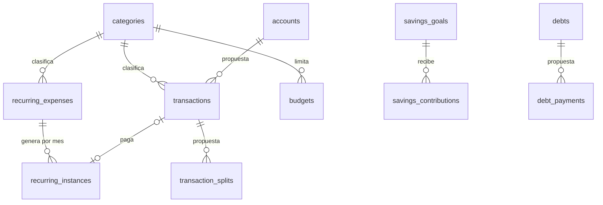

Quiero que crees (o, si ya existe, AGREGUES al final sin borrar nada) el archivo `FINANZAS_SPEC.md` en la raíz del proyecto. Debe ser la especificación completa de una aplicación de finanzas personales. Escríbelo en español, con checklists (`- [ ]`) y marca cada función como **[MVP]** o **[Después]**. Antes de escribir, revisa el código y los archivos existentes para no contradecir lo que ya está implementado; si algo ya existe, márcalo con `- [x]`.

## Estructura obligatoria del documento

### 0. Índice
Tabla de contenido con enlaces internos a todas las secciones y submenús.

### 1. Objetivo y alcance
Qué problema resuelve, a quién va dirigida, qué NO hará la app.

### 2. Mapa de navegación (menús y submenús)
Primero muestra el árbol completo de navegación en un bloque de código, por ejemplo:

```
📊 Dashboard
   ├─ Resumen del mes
   └─ Patrimonio neto
💸 Transacciones
   ├─ Ingresos
   ├─ Gastos
   └─ Transferencias
...
```

Luego desarrolla CADA menú como una sección `###` y CADA submenú como `####`. Dentro de cada submenú incluye siempre estos bloques:
- **Propósito**: una línea.
- **Funciones**: checklist con [MVP]/[Después].
- **Campos y datos**: nombre, tipo, obligatorio/opcional, validación.
- **Reglas de negocio** específicas de ese submenú.
- **Acciones y estados**: crear, editar, anular, archivar, filtros, orden, acciones masivas.
- **Casos borde y errores**: qué pasa si falla o hay datos inválidos.

Menús mínimos a desarrollar (agrega los que falten):

1. **Dashboard**: resumen del mes, patrimonio neto, flujo de caja, alertas, accesos rápidos.
2. **Transacciones**: ingresos, gastos, transferencias, divisiones de una transacción (split), adjuntos y notas, etiquetas, búsqueda y filtros avanzados, edición masiva.
3. **Cuentas**: efectivo, banco, ahorros, tarjetas de crédito, inversiones, conciliación de saldo, archivar cuenta.
4. **Categorías**: categorías y subcategorías, reglas de auto-categorización, categorías por defecto, reasignación al eliminar.
5. **Presupuestos**: por categoría, por mes, presupuesto flexible/rollover, alertas de límite, comparativo real vs. presupuestado.
6. **Metas de ahorro**: crear meta, aportes, progreso, fecha objetivo, proyección.
7. **Deudas y préstamos**: deudas, cuotas, intereses, calendario de pagos, simulador de pago anticipado, estrategias (bola de nieve/avalancha).
8. **Pagos recurrentes y suscripciones**: recurrentes, suscripciones, recordatorios, próximos vencimientos, pausar/cancelar.
9. **Tarjetas de crédito**: fecha de corte y pago, límite, utilización, estado de cuenta, pago mínimo vs. total.
10. **Registro mensual**: vista por mes, cierre de mes, comparativo con meses anteriores, reabrir mes (acción auditada).
11. **Reportes**: gastos por categoría, ingresos vs. gastos, tendencias, flujo de caja, patrimonio neto, reportes personalizados y guardados.
12. **Importar y exportar**: CSV, Excel, PDF, importación de estados de cuenta, mapeo de columnas, detección de duplicados, exportación completa en JSON/CSV.
13. **Notificaciones**: tipos, canales, horarios, preferencias.
14. **Configuración**: perfil, moneda y formato regional, zona horaria, tema, idioma, preferencias de la app.
15. **Seguridad y cuenta**: contraseña, 2FA, sesiones activas, historial de accesos, bloqueo de la app (PIN/biometría), eliminar cuenta y datos.
16. **Respaldos y sincronización**: respaldo manual y automático, restauración, sincronización opcional, resolución de conflictos.
17. **Ayuda y soporte**: onboarding, tutoriales, preguntas frecuentes, reportar un problema.

### 3. Reglas de negocio globales
- Todo el dinero con tipos decimales exactos (nunca `float`); definir redondeo y moneda.
- Una transferencia son dos movimientos ligados que no cuentan como ingreso ni gasto.
- Nada se borra en silencio: anulación o borrado lógico con auditoría.
- Meses cerrados no se editan sin acción explícita y registrada.
- Saldos calculados desde las transacciones (fuente única de verdad).
- Validaciones comunes: montos > 0, fechas válidas, cuenta y categoría obligatorias, detección de duplicados.
- Zonas horarias y formatos de fecha/moneda según el país del usuario.

### 4. Modelo de datos
Entidades, campos, relaciones, índices y restricciones (usuarios, cuentas, categorías, transacciones, presupuestos, metas, deudas, recurrentes, auditoría). Incluye un diagrama ER en Mermaid y la estrategia de migraciones.

### 5. Seguridad
- Autenticación: hash fuerte (argon2 o bcrypt), política de contraseñas, bloqueo por intentos fallidos, 2FA opcional, expiración y revocación de sesiones/tokens.
- Autorización: cada usuario solo accede a sus datos, validado en el backend.
- Cifrado en tránsito (TLS) y en reposo para datos sensibles y respaldos.
- Secretos en variables de entorno, `.env` fuera del repositorio.
- Protección contra inyección SQL, XSS, CSRF, rate limiting y validación estricta de entradas.
- Nunca guardar números completos de tarjeta, CVV ni credenciales bancarias; enmascarar datos en pantalla y logs.
- Logs de auditoría de acciones críticas sin información sensible.
- Escaneo de dependencias y actualizaciones periódicas.
- Plan de respuesta ante incidentes y recuperación de cuenta.

### 6. Privacidad y datos
Qué se recolecta, para qué, por cuánto tiempo; derecho a exportar y eliminar todo; sin telemetría ni terceros por defecto.

### 7. Requisitos no funcionales
Rendimiento, uso sin conexión, accesibilidad, diseño responsive/móvil, internacionalización (español por defecto), manejo de errores amigable.

### 8. Flujos clave (UX)
Registrar un gasto en menos de 10 segundos, onboarding, cierre de mes, importación de estado de cuenta, pago de tarjeta.

### 9. Pruebas y calidad
Pruebas unitarias de cálculos de dinero y reglas, pruebas de integración de la API, pruebas de seguridad básicas, datos de prueba y CI.

### 10. Hoja de ruta
Fases MVP, v1, v2, con criterios de aceptación medibles por fase.

### 11. Riesgos y decisiones abiertas
Supuestos, riesgos y preguntas para el equipo.

## Reglas para ti
- No inventes funciones que contradigan el stack actual.
- Sé específico, sin frases genéricas; cada submenú debe ser accionable.
- Usa la misma plantilla de bloques en todos los submenús para que el documento sea consistente.
- Si el documento queda demasiado largo, divídelo en `FINANZAS_SPEC.md` (índice y resumen) y archivos por menú dentro de `docs/finanzas/`, enlazados desde el índice.
- Al final, resume qué agregaste y qué información te faltó para definir.

---

# Especificación: Finanzas Personales

> Lo de arriba de esta línea es el encargo original y se conserva tal cual. Desde aquí empieza la especificación.
> Cada menú tiene su propio archivo en [`docs/finanzas/`](docs/finanzas/), enlazado desde el índice.
> `- [x]` significa que ya está implementado en el código (verificado el 2026-10-05, 65 pruebas en verde).
> **[MVP]** = necesario para la primera versión pública. **[Después]** = versiones siguientes.

## 0. Índice

1. [Objetivo y alcance](#1-objetivo-y-alcance)
2. [Mapa de navegación](#2-mapa-de-navegación-menús-y-submenús)
   1. [Dashboard (Inicio)](docs/finanzas/01-dashboard.md): [Resumen del mes](docs/finanzas/01-dashboard.md#resumen-del-mes) · [Patrimonio neto](docs/finanzas/01-dashboard.md#patrimonio-neto) · [Flujo de caja](docs/finanzas/01-dashboard.md#flujo-de-caja) · [Alertas](docs/finanzas/01-dashboard.md#alertas) · [Accesos rápidos](docs/finanzas/01-dashboard.md#accesos-rápidos)
   2. [Transacciones (Movimientos)](docs/finanzas/02-transacciones.md): [Ingresos y gastos](docs/finanzas/02-transacciones.md#ingresos-y-gastos) · [Transferencias](docs/finanzas/02-transacciones.md#transferencias) · [División (split)](docs/finanzas/02-transacciones.md#división-de-una-transacción-split) · [Adjuntos y notas](docs/finanzas/02-transacciones.md#adjuntos-y-notas) · [Etiquetas](docs/finanzas/02-transacciones.md#etiquetas) · [Búsqueda y filtros](docs/finanzas/02-transacciones.md#búsqueda-y-filtros-avanzados) · [Edición masiva](docs/finanzas/02-transacciones.md#edición-masiva)
   3. [Cuentas](docs/finanzas/03-cuentas.md): [Lista de cuentas](docs/finanzas/03-cuentas.md#lista-de-cuentas) · [Conciliación](docs/finanzas/03-cuentas.md#conciliación-de-saldo) · [Archivar cuenta](docs/finanzas/03-cuentas.md#archivar-cuenta)
   4. [Categorías](docs/finanzas/04-categorias.md): [Categorías y subcategorías](docs/finanzas/04-categorias.md#categorías-y-subcategorías) · [Categorías por defecto](docs/finanzas/04-categorias.md#categorías-por-defecto) · [Auto-categorización](docs/finanzas/04-categorias.md#reglas-de-auto-categorización) · [Reasignación al eliminar](docs/finanzas/04-categorias.md#reasignación-al-eliminar)
   5. [Presupuestos](docs/finanzas/05-presupuestos.md): [Por categoría y mes](docs/finanzas/05-presupuestos.md#presupuesto-por-categoría-y-mes) · [Rollover](docs/finanzas/05-presupuestos.md#presupuesto-flexible-rollover) · [Alertas de límite](docs/finanzas/05-presupuestos.md#alertas-de-límite) · [Real vs. presupuestado](docs/finanzas/05-presupuestos.md#comparativo-real-vs-presupuestado)
   6. [Metas de ahorro](docs/finanzas/06-metas.md): [Metas](docs/finanzas/06-metas.md#metas) · [Aportes](docs/finanzas/06-metas.md#aportes) · [Progreso y proyección](docs/finanzas/06-metas.md#progreso-fecha-objetivo-y-proyección)
   7. [Deudas y préstamos](docs/finanzas/07-deudas.md): [Deudas](docs/finanzas/07-deudas.md#deudas-y-préstamos) · [Calendario de cuotas](docs/finanzas/07-deudas.md#cuotas-e-intereses) · [Simulador y estrategias](docs/finanzas/07-deudas.md#simulador-y-estrategias)
   8. [Pagos recurrentes y suscripciones](docs/finanzas/08-recurrentes.md): [Gastos fijos](docs/finanzas/08-recurrentes.md#gastos-fijos-recurrentes) · [Suscripciones](docs/finanzas/08-recurrentes.md#suscripciones) · [Próximos vencimientos y recordatorios](docs/finanzas/08-recurrentes.md#próximos-vencimientos-y-recordatorios) · [Pausar y cancelar](docs/finanzas/08-recurrentes.md#pausar-y-cancelar)
   9. [Tarjetas de crédito](docs/finanzas/09-tarjetas.md): [Datos de la tarjeta](docs/finanzas/09-tarjetas.md#datos-de-la-tarjeta) · [Estado de cuenta y pago](docs/finanzas/09-tarjetas.md#estado-de-cuenta-y-pago)
   10. [Registro mensual](docs/finanzas/10-registro-mensual.md): [Vista por mes](docs/finanzas/10-registro-mensual.md#vista-por-mes) · [Cierre y reapertura](docs/finanzas/10-registro-mensual.md#cierre-y-reapertura-de-mes) · [Comparativo](docs/finanzas/10-registro-mensual.md#comparativo-con-meses-anteriores)
   11. [Reportes](docs/finanzas/11-reportes.md): [Gastos por categoría](docs/finanzas/11-reportes.md#gastos-por-categoría) · [Ingresos vs. gastos y tendencias](docs/finanzas/11-reportes.md#ingresos-vs-gastos-y-tendencias) · [Reportes guardados](docs/finanzas/11-reportes.md#reportes-personalizados-y-guardados)
   12. [Importar y exportar](docs/finanzas/12-importar-exportar.md): [Exportar](docs/finanzas/12-importar-exportar.md#exportar) · [Importar CSV/Excel](docs/finanzas/12-importar-exportar.md#importar-csv-y-excel) · [Estados de cuenta](docs/finanzas/12-importar-exportar.md#importar-estados-de-cuenta)
   13. [Notificaciones](docs/finanzas/13-notificaciones.md): [Tipos y preferencias](docs/finanzas/13-notificaciones.md#tipos-y-preferencias)
   14. [Configuración (Ajustes)](docs/finanzas/14-configuracion.md): [Moneda y formato](docs/finanzas/14-configuracion.md#moneda-y-formato-regional) · [Tema e idioma](docs/finanzas/14-configuracion.md#tema-idioma-y-preferencias) · [Perfil](docs/finanzas/14-configuracion.md#perfil)
   15. [Seguridad y cuenta](docs/finanzas/15-seguridad.md): [Bloqueo de la app](docs/finanzas/15-seguridad.md#bloqueo-de-la-app-pin-y-biometría) · [Borrar todos los datos](docs/finanzas/15-seguridad.md#borrar-todos-los-datos) · [Cuenta en línea](docs/finanzas/15-seguridad.md#cuenta-en-línea-contraseña-2fa-sesiones)
   16. [Respaldos y sincronización](docs/finanzas/16-respaldos.md): [Respaldo y restauración](docs/finanzas/16-respaldos.md#respaldo-manual-y-automático) · [Sincronización](docs/finanzas/16-respaldos.md#sincronización-opcional)
   17. [Ayuda y soporte](docs/finanzas/17-ayuda.md): [Onboarding](docs/finanzas/17-ayuda.md#onboarding) · [Preguntas frecuentes](docs/finanzas/17-ayuda.md#preguntas-frecuentes-y-tutoriales) · [Reportar un problema](docs/finanzas/17-ayuda.md#reportar-un-problema)
3. [Reglas de negocio globales](#3-reglas-de-negocio-globales)
4. [Modelo de datos](#4-modelo-de-datos)
5. [Seguridad](#5-seguridad)
6. [Privacidad y datos](#6-privacidad-y-datos)
7. [Requisitos no funcionales](#7-requisitos-no-funcionales)
8. [Flujos clave (UX)](#8-flujos-clave-ux)
9. [Pruebas y calidad](#9-pruebas-y-calidad)
10. [Hoja de ruta](#10-hoja-de-ruta)
11. [Riesgos y decisiones abiertas](#11-riesgos-y-decisiones-abiertas)
12. [Qué se agregó y qué faltó](#12-qué-se-agregó-y-qué-faltó)

## 1. Objetivo y alcance

**Problema.** Llevar las finanzas del mes cuesta: los gastos fijos se olvidan, no se sabe cuánto queda por categoría y el ahorro se mide "a ojo". La app permite registrar cada peso del mes en segundos y ver de inmediato el balance, lo pendiente y el porcentaje ahorrado.

**Para quién.** Una persona (no una familia ni una empresa) en República Dominicana que cobra en pesos, a veces maneja dólares y quiere control mensual desde el teléfono, sin crear cuentas en línea.

**Qué hace hoy (v0.1).** Registro de ingresos y gastos por mes, gastos fijos con estado Pagado/Pendiente, metas de ahorro con aportes, presupuestos por categoría, resumen mensual con % de ahorro, categorías editables y moneda DOP/USD. Todo se guarda en SQLite dentro del teléfono.

**Qué NO hará la app:**
- No se conecta a bancos ni lee SMS o correos del banco (solo importación manual de archivos, [Después]).
- No mueve dinero, no paga facturas y no es un monedero.
- No convierte monedas automáticamente ni consulta tasas en línea. La moneda elegida solo cambia el símbolo.
- No da asesoría financiera ni recomendaciones de inversión.
- No es multiusuario ni compartido mientras no exista la sincronización opcional ([Después], sección 16).
- No envía datos a terceros ni tiene telemetría.

## 2. Mapa de navegación (menús y submenús)

Estado: ✅ existe · 🟡 existe en parte · ⬜ no existe. Los nombres entre paréntesis son los que se ven hoy en la app.

```
📊 Dashboard (pestaña "Inicio")
   ├─ ✅ Resumen del mes (tarjeta de balance)
   ├─ ⬜ Patrimonio neto
   ├─ ⬜ Flujo de caja
   ├─ 🟡 Alertas (presupuesto pasado, balance negativo)
   └─ 🟡 Accesos rápidos (botón +, "Ver todos", engranaje)
💸 Transacciones (pestaña "Movimientos")
   ├─ ✅ Ingresos y gastos (crear, editar, duplicar, eliminar)
   ├─ ⬜ Transferencias
   ├─ ⬜ División de una transacción (split)
   ├─ 🟡 Adjuntos y notas (solo nota)
   ├─ ⬜ Etiquetas
   ├─ ⬜ Búsqueda y filtros avanzados
   └─ ⬜ Edición masiva
🏦 Cuentas
   ├─ ⬜ Lista de cuentas (efectivo, banco, ahorros, tarjeta, inversión)
   ├─ ⬜ Conciliación de saldo
   └─ ⬜ Archivar cuenta
🏷️ Categorías (en Ajustes)
   ├─ 🟡 Categorías y subcategorías (sin subcategorías)
   ├─ ✅ Categorías por defecto
   ├─ ⬜ Reglas de auto-categorización
   └─ 🟡 Reasignación al eliminar (hoy se bloquea si está en uso)
🎯 Presupuestos (tarjeta en Inicio)
   ├─ ✅ Presupuesto por categoría y mes
   ├─ ⬜ Presupuesto flexible (rollover)
   ├─ 🟡 Alertas de límite (solo visuales)
   └─ ⬜ Comparativo real vs. presupuestado
💰 Metas de ahorro (pestaña "Ahorro")
   ├─ ✅ Metas
   ├─ ✅ Aportes
   └─ 🟡 Progreso, fecha objetivo y proyección (sin fecha ni proyección)
🧾 Deudas y préstamos
   ├─ ⬜ Deudas y préstamos
   ├─ ⬜ Cuotas e intereses
   └─ ⬜ Simulador y estrategias
🔁 Pagos recurrentes y suscripciones (pestaña "Fijos")
   ├─ ✅ Gastos fijos recurrentes
   ├─ 🟡 Suscripciones (como categoría de gasto fijo)
   ├─ 🟡 Próximos vencimientos y recordatorios (sin recordatorios)
   └─ 🟡 Pausar y cancelar (solo "eliminar desde este mes")
💳 Tarjetas de crédito
   ├─ ⬜ Datos de la tarjeta
   └─ ⬜ Estado de cuenta y pago
📅 Registro mensual (selector de mes en todas las pestañas)
   ├─ ✅ Vista por mes
   ├─ ⬜ Cierre y reapertura de mes
   └─ ⬜ Comparativo con meses anteriores
📈 Reportes
   ├─ 🟡 Gastos por categoría (dona del mes en Inicio)
   ├─ ⬜ Ingresos vs. gastos y tendencias
   └─ ⬜ Reportes personalizados y guardados
⇅ Importar y exportar
   ├─ ⬜ Exportar
   ├─ ⬜ Importar CSV y Excel
   └─ ⬜ Importar estados de cuenta
🔔 Notificaciones
   └─ ⬜ Tipos y preferencias
⚙️ Configuración (pantalla "Ajustes")
   ├─ ✅ Moneda y formato regional
   ├─ ⬜ Tema, idioma y preferencias
   └─ ⬜ Perfil
🔒 Seguridad y cuenta
   ├─ ⬜ Bloqueo de la app (PIN y biometría)
   ├─ ⬜ Borrar todos los datos
   └─ ⬜ Cuenta en línea (solo si llega la sincronización)
☁️ Respaldos y sincronización
   ├─ ⬜ Respaldo manual y automático
   └─ ⬜ Sincronización opcional
❓ Ayuda y soporte
   ├─ ⬜ Onboarding
   ├─ ⬜ Preguntas frecuentes y tutoriales
   └─ ⬜ Reportar un problema
```

**Navegación actual y propuesta.** La barra inferior tiene 4 pestañas (Inicio, Movimientos, Fijos, Ahorro) y no caben más en 360 px. Los menús nuevos no deben añadir pestañas: Cuentas, Deudas, Tarjetas, Reportes, Importar/Exportar, Respaldos, Seguridad y Ayuda se abren desde Ajustes o desde una pantalla "Más" que reemplace al engranaje. Decisión abierta en la [sección 11](#11-riesgos-y-decisiones-abiertas).

Cada menú se desarrolla en su archivo, con la misma plantilla en todos los submenús: **Propósito**, **Funciones**, **Campos y datos**, **Reglas de negocio**, **Acciones y estados**, **Casos borde y errores**.

## 3. Reglas de negocio globales

- [x] **[MVP] Dinero exacto.** Los montos se guardan y se calculan como centavos enteros (RD$12.50 = 1250), nunca con `float`. La UI convierte solo al mostrar (`formatMoney`) y al leer campos (`parseAmount`, redondeo al centavo más cercano). Migración 4.
- [x] **[MVP] Una moneda de visualización.** DOP o USD, elegida en Ajustes. No se convierten montos: cambiar la moneda cambia solo el símbolo.
- [ ] **[Después] Multimoneda real.** Cada cuenta con su moneda y transferencias entre monedas con tasa manual registrada en la transferencia. Requiere Cuentas.
- [ ] **[Después] Transferencias.** Una transferencia son dos movimientos ligados (salida y entrada con el mismo `transfer_id`) que no cuentan como ingreso ni gasto en el resumen ni en los reportes.
- [x] **[MVP] El mes es un filtro por fecha**, no una copia de datos. Ningún registro se duplica al cambiar de mes; los presupuestos se copian solo si el usuario lo pide.
- [x] **[MVP] Fecha propuesta.** Al crear un registro, la fecha propuesta es hoy si se ve el mes actual; si no, el mismo día dentro del mes que se está viendo.
- [ ] **[MVP] Nada se borra en silencio.** Hoy todo borrado pide confirmación con texto que dice qué se pierde. Falta el borrado lógico (`deleted_at`) y la tabla de auditoría, más la opción "Deshacer" durante unos segundos.
- [ ] **[Después] Meses cerrados.** Un mes cerrado no admite crear, editar ni borrar registros con fecha dentro de él, salvo reabriéndolo con una acción explícita que queda en la auditoría.
- [ ] **[Después] Saldos derivados.** El saldo de una cuenta = saldo inicial + suma de sus movimientos. Nunca se guarda un saldo "a mano" fuera de un ajuste de conciliación, que es en sí un movimiento.
- [x] **[MVP] Validaciones comunes.** Montos > 0 y enteros en centavos. Fechas que existen en el calendario (`isValidIsoDate`). Categoría obligatoria y existente. Textos recortados.
- [ ] **[MVP] Cuenta obligatoria** en cada movimiento, cuando exista el menú Cuentas (con "Efectivo" por defecto para los datos viejos).
- [ ] **[Después] Detección de duplicados.** Advertir (no bloquear) si se guarda un movimiento con la misma fecha, monto y categoría que otro de las últimas 24 h.
- [x] **[MVP] Resumen mensual.** Balance = ingresos − gastos − ahorrado. % ahorro = ahorrado / ingresos. Calificación: ≥ 20% excelente, ≥ 10% regular, menos es bajo. Sin ingresos no hay porcentaje.
- [x] **[MVP] Formato regional** `es-DO` para fechas y montos. La zona horaria es la del teléfono. Las fechas se guardan como texto `YYYY-MM-DD` sin hora, así un movimiento nunca "cambia de día" por la zona horaria.
- [x] **[MVP] Esquema solo por migraciones** numeradas y en una transacción. Ninguna migración publicada se edita.

## 4. Modelo de datos

### Tablas actuales (migraciones 1 a 5)

| Tabla | Campos | Restricciones e índices |
|---|---|---|
| `categories` | `id` TEXT PK, `name` TEXT, `type` TEXT | `type IN ('ingreso','fijo','variable')`. Nombre único sin distinguir mayúsculas (validado en la aplicación). |
| `transactions` | `id` TEXT PK, `date` TEXT `YYYY-MM-DD`, `amount` INTEGER centavos, `category_id` → categories, `note` TEXT | `amount > 0`, índice `idx_transactions_date`. No se puede borrar una categoría con movimientos. |
| `recurring_expenses` | `id`, `name`, `amount`, `category_id` → categories, `due_day` 1-31, `active` 0/1, `start_month` `YYYY-MM` | `amount > 0`, `due_day BETWEEN 1 AND 31`. |
| `recurring_instances` | PK (`recurring_expense_id`, `month`), `due_date`, `amount`, `status`, `transaction_id` → transactions | `status IN ('pagado','pendiente')`. Se borra en cascada con la plantilla. `transaction_id` pasa a NULL si se borra el movimiento. |
| `savings_goals` | `id`, `name`, `target_amount` | `target_amount > 0`. |
| `savings_contributions` | `id`, `goal_id` → savings_goals, `date`, `amount` | `amount > 0`, cascada al borrar la meta, índice `idx_contributions_date`. |
| `budgets` | `id`, `category_id` → categories, `month`, `limit_amount` | Único (`category_id`, `month`), cascada al borrar la categoría. |
| `settings` | `key` TEXT PK, `value` TEXT | Hoy solo `currency`. |
| `schema_migrations` | `version` PK, `name`, `applied_at` | Control de migraciones. |

### Tablas propuestas

| Tabla | Para qué | Fase |
|---|---|---|
| `accounts` (`id`, `name`, `type`, `currency`, `opening_balance`, `archived_at`) | Menú Cuentas. Se agrega `account_id` a `transactions`. | [MVP] |
| `audit_log` (`id`, `at`, `action`, `entity`, `entity_id`, `summary`) | Borrados, cierres y reaperturas de mes. Sin montos ni notas en `summary`. | [MVP] |
| `deleted_at` en `transactions`, `savings_contributions`, `recurring_expenses` | Borrado lógico con "Deshacer". | [MVP] |
| `tags`, `transaction_tags` | Etiquetas libres. | [Después] |
| `transaction_splits` (`transaction_id`, `category_id`, `amount`) | División de un movimiento en varias categorías. | [Después] |
| `month_closures` (`month` PK, `closed_at`, `reopened_at`) | Cierre de mes. | [Después] |
| `debts`, `debt_payments` | Deudas y préstamos. | [Después] |
| `credit_cards` (`account_id`, `closing_day`, `due_day`, `credit_limit`) | Tarjetas, como cuenta de tipo tarjeta. | [Después] |
| `categorization_rules` (`pattern`, `category_id`) | Auto-categorización por texto de la nota. | [Después] |
| `attachments` (`transaction_id`, `path`, `mime`) | Fotos de recibos en el almacenamiento privado de la app. | [Después] |

No habrá tabla `users` mientras la app sea 100% local: hay un solo usuario, el dueño del teléfono.



### Estrategia de migraciones

- [x] Cada cambio de esquema es una migración numerada en `src/app/infrastructure/sqlite/migrations.ts`, aplicada en una transacción y registrada en `schema_migrations`.
- [x] Una migración que falla se revierte entera (probado).
- [x] Las migraciones que transforman datos (como la 4, a centavos) llevan prueba con datos viejos.
- [ ] [MVP] Antes de aplicar migraciones con cambios destructivos, hacer un respaldo automático del archivo de la base de datos (ver Respaldos).

## 5. Seguridad

La app no tiene backend: no hay servidor, API, contraseñas en línea ni sesiones. Por eso varios puntos del encargo **no aplican hoy**. Quedan descritos para cuando llegue la sincronización opcional, sin inventar un backend.

- [ ] **[MVP] Bloqueo local.** PIN de 4 a 6 dígitos y huella o rostro mediante la biometría de Android. El PIN se guarda solo como hash con salt (PBKDF2 o argon2 del lado del teléfono), nunca en claro. Tras 5 intentos fallidos se espera 30 s, y el tiempo se duplica en cada fallo siguiente. Ver [Seguridad y cuenta](docs/finanzas/15-seguridad.md).
- ~~**[MVP] Cifrado en reposo.**~~ **Descartado (2026-10-05).** El plugin guarda la clave de SQLCipher en preferencias cifradas con una llave del Keystore, y esa llave se perdió una vez en el teléfono del usuario ("CapacitorSQLitePlugin: null"). Sin cifrar, ese fallo solo impidió abrir la app hasta corregirlo; con la base cifrada habría significado perder todos los datos sin recuperación. Los datos ya quedan protegidos por el cifrado del almacenamiento de Android, el aislamiento entre apps, el PIN o la huella, y los respaldos cifrados con contraseña. Se reconsidera solo si antes hay respaldos automáticos.
- [ ] **[MVP] Respaldos cifrados** con una contraseña elegida por el usuario. Un respaldo nunca sale del teléfono sin cifrar.
- [x] **Inyección SQL.** Todas las consultas usan parámetros (`?`). Las únicas cadenas concatenadas son las migraciones fijas del código.
- [x] **XSS.** Angular escapa todo el texto de la interfaz y no se usa `innerHTML` con datos del usuario.
- [ ] **[MVP] Capturas de pantalla.** Opción para impedir capturas y ocultar el contenido en la vista de apps recientes (`FLAG_SECURE`).
- [x] **Datos sensibles.** No se piden ni guardan números de tarjeta, CVV ni credenciales bancarias. Las tarjetas futuras guardan solo un nombre y, como mucho, los últimos 4 dígitos.
- [x] **Logs.** `console.error` registra errores técnicos sin montos ni notas.
- [ ] **[Después] Dependencias.** `npm audit` en CI y actualización trimestral de Angular, Ionic y Capacitor.
- **No aplica sin backend:** hash de contraseñas en servidor, 2FA, expiración y revocación de sesiones, autorización por usuario en backend, TLS, CSRF, rate limiting, secretos en `.env`. Se activan solo si se aprueba la sincronización (sección 16) y se especificarán entonces.
- [ ] **[MVP] Incidentes.** Sin servidor, el riesgo principal es perder el teléfono. El plan es: bloqueo con PIN, base cifrada y respaldo cifrado restaurable en otro teléfono.

## 6. Privacidad y datos

- **Qué se recolecta:** solo lo que el usuario escribe (montos, fechas, notas, categorías, metas, presupuestos) y su preferencia de moneda.
- **Dónde vive:** en la base SQLite privada de la app en el teléfono. En el navegador de desarrollo, en IndexedDB.
- **Para qué:** únicamente para mostrarle sus propias finanzas.
- **Por cuánto tiempo:** hasta que el usuario lo borre o desinstale la app.
- [ ] **[MVP] Derecho a exportar todo:** exportación completa en JSON y CSV (ver [Importar y exportar](docs/finanzas/12-importar-exportar.md)).
- [ ] **[MVP] Derecho a borrar todo:** "Borrar todos los datos" en Seguridad, con doble confirmación.
- [x] **Sin telemetría ni terceros:** la app no hace llamadas de red. Las fuentes van empaquetadas, sin Google Fonts.
- [ ] **[MVP] Política de privacidad** de una página dentro de Ayuda, y en la ficha de Play Store si se publica.

## 7. Requisitos no funcionales

- [x] **Uso sin conexión:** total, porque no hay red.
- [ ] **[MVP] Rendimiento:** abrir la app y ver Inicio en menos de 1.5 s en un Android de gama media. Cambiar de mes en menos de 300 ms con 5,000 movimientos (los índices por fecha ya existen). Medirlo en un teléfono real antes de publicar.
- [x] **Accesibilidad:** contraste AA (tokens `--muted-on-light`, `--positive-on-light`), zonas táctiles de 48 px, foco visible, `aria-live` en mensajes y `prefers-reduced-motion` respetado.
- [ ] **[MVP] Revisión con TalkBack** en un teléfono real (pendiente).
- [x] **Diseño móvil:** probado de 360 a 430 px de ancho.
- [ ] **[Después] Tablet y PC:** contenido centrado a 480 px o dos columnas desde 900 px (design.md, sección 8).
- [x] **Idioma:** español. [ ] [Después] textos centralizados para traducir a inglés.
- [x] **Errores amigables:** cada pantalla tiene estados vacío y de error con una acción. Los formularios muestran el motivo exacto de la validación.
- [ ] **[MVP] Estado de carga** visible si una consulta tarda más de 300 ms. Hoy la pantalla queda en blanco mientras carga.

## 8. Flujos clave (UX)

**Registrar un gasto en menos de 10 segundos** — [x] hoy son 5 toques:
1. Tocar **+**.
2. Elegir la categoría.
3. Escribir el monto.
4. Tocar **Guardar gasto**.
5. Se ve el check de éxito.

La fecha ya viene propuesta y la nota es opcional. Mejora [Después]: recordar la última categoría usada.

**Onboarding** — [ ] [MVP], primera apertura:
1. Bienvenida de una pantalla: qué hace la app y que todo queda en el teléfono.
2. Elegir moneda.
3. Registrar el ingreso del mes (opcional).
4. Agregar los gastos fijos principales (opcional).
5. Ir a Inicio.

Ningún paso es obligatorio salvo la moneda.

**Cierre de mes** — [ ] [Después]:
1. El último día del mes, o al abrir el mes siguiente, la app ofrece revisar el mes.
2. Muestra los fijos pendientes, el balance final y la comparación con el mes anterior.
3. Botón **Cerrar mes**.
4. Ofrece copiar los presupuestos al mes nuevo.

**Importar estado de cuenta** — [ ] [Después]:
1. Elegir el archivo CSV o Excel.
2. Asignar las columnas (fecha, descripción, monto).
3. Vista previa con duplicados marcados.
4. Asignar categorías, sugeridas por las reglas.
5. Confirmar.

**Pago de tarjeta** — [ ] [Después]:
1. En la tarjeta, **Pagar**.
2. Elegir monto (mínimo, total o otro) y cuenta de origen.
3. Se crea una transferencia de la cuenta a la tarjeta, que no cuenta como gasto.

**Pagar un gasto fijo** — [x]:
1. En Fijos, **Marcar como pagado**.
2. Se crea el gasto en Movimientos y el fijo pasa a Pagado, con el check.

## 9. Pruebas y calidad

- [x] **Unitarias de dinero y reglas** (Vitest): resumen mensual y umbrales, centavos (`parseAmount`/`formatMoney`), fechas (`isValidIsoDate`, `daysBetween`, `defaultDateFor`), desglose por categoría, presupuestos, metas y categorías.
- [x] **Integración de persistencia** con SQLite real en memoria (`node:sqlite`): migraciones (incluida la falla con reversión y la conversión a centavos), restricciones (montos, únicos, cascadas) y cada consulta de repositorio.
- [x] **Casos de uso con repositorios en memoria:** concurrencia (una lectura tardía no pisa un pago) y compensación (si falla marcar un pago, se borra el gasto creado).
- [x] **Componentes:** Inicio y Fijos con datos y vacíos.
- [ ] [MVP] **Pruebas de flujos en el navegador** (crear, editar, pagar, recargar y persistir). Hoy se hacen manualmente con Chrome sin ventana: convertirlas en un script de Playwright.
- [ ] [MVP] **CI en GitHub Actions:** `npm ci`, `ng lint`, `ng test`, `ng build` en cada push, y el APK de debug como artefacto.
- [ ] [MVP] **Prueba manual en Android** antes de cada versión: instalar sobre la anterior y comprobar que los datos se conservan y las migraciones corren.
- **No aplica sin backend:** pruebas de integración de API y de seguridad de servidor.
- **Datos de prueba:** los tests crean sus propios datos. [ ] [Después] un botón oculto de "datos de ejemplo" en builds de debug.

## 10. Hoja de ruta

### MVP (primera versión pública en Play Store)

Lo que ya existe:
- [x] Movimientos, Fijos, Ahorro, Presupuestos, Ajustes, resumen mensual, centavos, migraciones y persistencia en Android y navegador.

Lo que falta:
- [ ] Cuentas (al menos Efectivo, Banco y Tarjeta) con saldo derivado.
- [ ] Exportar todo (JSON y CSV) y restaurar desde JSON.
- [x] Bloqueo con PIN y biometría. (La base de datos cifrada se descartó; ver sección de seguridad.)
- [ ] Búsqueda por nota y filtro por categoría en Movimientos.
- [ ] Borrado lógico con "Deshacer" y auditoría.
- [ ] Onboarding y estado de carga.
- [ ] APK firmado (release) y CI.

**Criterios de aceptación medibles:**
- Registrar un gasto en 10 s o menos, medido con 5 personas.
- Inicio visible en menos de 1.5 s en gama media.
- Cero pérdida de datos al actualizar de v0.1 al MVP (prueba con una base real de v0.1).
- Restaurar un respaldo en otro teléfono reproduce el mismo balance de cada mes.
- Ninguna pantalla sin estado vacío ni de error.
- Contraste AA en todos los textos.

### v1

- [ ] Transferencias y tarjetas de crédito (corte, pago, utilización).
- [ ] Recordatorios de vencimiento con notificaciones locales.
- [ ] Reportes: ingresos vs. gastos de 6 meses y tendencias por categoría.
- [ ] Cierre de mes y comparativo con el mes anterior.
- [ ] Subcategorías y reasignación al eliminar.
- [ ] Fecha objetivo y proyección en metas.
- [ ] Importar CSV con mapeo de columnas y detección de duplicados.

**Criterios:**
- Una transferencia no altera el balance del mes (prueba automatizada).
- Las notificaciones llegan con la app cerrada en Android 8 a 16.
- Una importación de 500 filas tarda menos de 5 s y marca los duplicados exactos.

### v2

- [ ] Deudas con estrategias bola de nieve/avalancha y simulador.
- [ ] Split y etiquetas.
- [ ] Rollover de presupuestos.
- [ ] Reportes guardados.
- [ ] Adjuntos (fotos de recibos).
- [ ] Sincronización opcional cifrada de extremo a extremo.
- [ ] Versión de escritorio (la misma app web en PC).

**Criterios:**
- El simulador de deudas coincide al centavo con una tabla de amortización de referencia.
- La sincronización resuelve conflictos sin perder registros (pruebas con dos dispositivos editando el mismo mes).

## 11. Riesgos y decisiones abiertas

**Supuestos:**
- Un usuario por teléfono.
- La mayoría de montos en DOP.
- El teléfono tiene Android 7 o superior (minSdk 24).

**Riesgos:**
- **Pérdida del teléfono = pérdida total.** No hay respaldo hasta implementar Respaldos. Es el riesgo más alto.
- **Base sin cifrar.** Hoy cualquiera con acceso root al teléfono puede leer las finanzas.
- **Navegación saturada.** Agregar 10 menús nuevos sin rediseñar la navegación rompería la barra de 4 pestañas.
- **`design.md` desactualizado.** Sus secciones 4 y 10.1 describen pestañas "Mes, Ahorros, Resumen" que no existen, y faltan los tokens de superficie suave que usa el código. Conviene alinearlo antes de diseñar pantallas nuevas.
- **Transferencias y tarjetas** cambian el modelo (cuenta obligatoria por movimiento). Hacerlo tarde implica migrar todos los datos con una cuenta por defecto.

**Preguntas para decidir:**
1. ¿La app se publicará en Play Store o es de uso personal? Cambia la urgencia del APK firmado, la política de privacidad y el onboarding.
2. ¿Dónde viven los menús nuevos: pantalla "Más" en lugar del engranaje, o dentro de Ajustes?
3. ¿Hace falta multimoneda real (cuentas en USD con su saldo), o basta el símbolo global de hoy?
4. ¿La sincronización es un objetivo real? Si no, la sección 5 queda solo con seguridad local.
5. Gastos fijos que son ingresos (sueldo fijo): ¿se modelan como "ingreso recurrente" en Fijos, o aparte?
6. ¿Qué bancos se importarían primero? Se necesita un estado de cuenta de ejemplo de cada uno para el mapeo.

## 12. Qué se agregó y qué faltó

**Agregado (2026-10-05):**
- Esta especificación completa: secciones 0 a 11 y 17 archivos de menú en `docs/finanzas/`, con la misma plantilla en cada submenú.
- Verificada contra el código: cada `[x]` corresponde a algo implementado y probado (65 pruebas).
- Lo que el encargo pedía y contradice el stack actual (backend, 2FA, sesiones, TLS, API) quedó marcado como **No aplica sin backend**, sin inventar un servidor.

**Información que faltó para definir:**
- Si la app se publicará y para cuántos usuarios.
- Bancos y formatos de estados de cuenta reales.
- Si se necesita multimoneda real.
- Política de retención para borrados lógicos (¿cuántos días se puede deshacer?).
- Si la sincronización es un objetivo o se descarta.
- Textos legales (privacidad) y un correo de soporte para "Reportar un problema".
